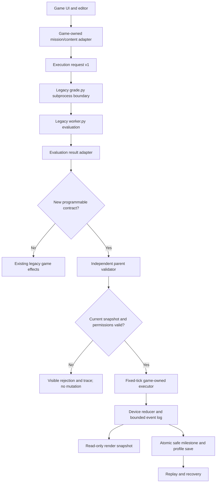

# 09 — Architecture and Data Contracts (implementation-ready design)

**Status:** Stage-09 planning complete; **not implemented** in the shipped game.  
**Baseline:** Python Quest 2D v1.4, 76 playable missions, profile schema 4.  
**Scope:** Typed JSON boundaries, adapters to existing Python worker and Pygame world, deterministic planning/deployment, replay, save compatibility, and test gates.  
**Authority:** `engineering/09_CONTRACT_REGISTRY.json`, the 13 JSON Schemas in `engineering/schemas/`, 13 positive and 12 negative examples in `engineering/examples/`, `engineering/09_STATE_MACHINES.json`, source/save matrices, and `reference/contracts_v1.py`. Source project is **read-only** during this preproduction stage.

## 1. Architectural decision record

| ID | Decision | Reason / invariant |
|---|---|---|
| AD09-01 | Keep current Pygame game loop and `core.grade.grade()`/worker pipeline for 76 shipped missions. | No replacement engine, no regression to existing terminal/editor, rover, missions, XP or saves. |
| AD09-02 | New learner-authored programs return **plain-data actions**; only game-owned code changes world state. | No Python classes/functions cross worker boundary; no player code executes inside frame loop. |
| AD09-03 | Treat worker output as untrusted even when unit tests pass; validate in parent process **again** against fresh world state. | Worker checks educational results; game process authorizes effects. |
| AD09-04 | Version new boundaries independently (`protocol_version:1` and `schema:1`); retain save `schema_version:4` while additions are optional. | Supports additive rollout and old player profiles without forced migration. |
| AD09-05 | Frozen observation → verified output → parent revalidation → game-owned fixed-tick action execution → atomic world milestone → persist. | Reproducible replay; no partial repair after crash/quit. |
| AD09-06 | Preserve all unknown/legacy save fields and existing mission IDs; duplicate XP grants must remain zero. | Existing player ownership and progress survive new features. |
| AD09-07 | Use snapshot IDs + canonical digests, never mutable object references as verification. | A plan for one map state cannot silently execute on another. |
| AD09-08 | Keep 3D heart/medical hardware integration educational and synthetic in the existing Pygame stack. | No clinical use, no new Qt runtime dependency, no non-synthetic data. |
| AD09-09 | Apply new contracts through feature-gated wrappers one subsystem at a time. | Safe fallback and rollback for legacy missions and screens. |
| AD09-10 | JSON Schema validates *shape*, while reference checks validate *meaning* and runtime authority. | Data matching schema may still be stale, colliding, unauthorized or semantically invalid. |

## 2. What is really in v1.4

The following code paths were identified in the archived v1.4 source and matched by source-linked tests:

- `src/python_quest_2d/core/challenges.py`: loads `LESSONS`, map JSON and challenge metadata. Existing content formats include script/function/object/expedition simulation cases.
- `src/python_quest_2d/core/grade.py:grade(ch, code, timeout_s=3)`: spawns worker with `python -I -S`, a 3-second timeout, a temporary working directory, selected environment variables, and a 64 KiB Python-source bound.
- `src/python_quest_2d/core/worker.py:evaluate(ch, code)`: executes learner code on disposable cases. Existing result formats include different effects for basic scripts, function calls, objects, rover paths and engineering simulations.
- `src/python_quest_2d/game/app.py`: owns main event loop, collection of worker results, screen and animations. Its legacy `collect()` path may call expedition-specific acceptance logic.
- `src/python_quest_2d/game/expedition.py:Expeditions.accept()` validates rover/expedition results and stores `programs`, `last_replay`, `expedition_job`; `travel(index)` owns travel gates and checkpoints.
- `src/python_quest_2d/game/world.py`: tiles, collision, interactables and spawn coordinates.
- `src/python_quest_2d/core/progress.py:load()/save()/award()`: profile schema 4, legacy schema 2/3 upgrades, atomic replace, idempotent awards. No strict newer-version rejection is enforced in the v1.4 loader.
- `src/python_quest_2d/game/pixel_world.py`, `presentation.py`, `diagnostics.py`, `instruments.py`, `planet_art.py`: rendering, transitions, overlays, synthetic readouts. Never call learner code from these draw paths.

**Important:** the existing `-I -S` worker and timeout are not an OS-level sandbox; do not claim that this safely runs hostile code or run downloaded third-party Python scripts. New size/JSON validation is input hygiene, not a security guarantee.

## 3. Proposed boundary diagram

The canonical editable diagrams are `engineering/09_ARCHITECTURE.mmd` and `engineering/09_DEPLOYMENT_SEQUENCE.mmd`.



`core.grade` remains a synchronous worker subprocess boundary in the first compatibility release. Subsequent background-task support is permitted only after a UI responsiveness review and cancellation tests; new services must not create overlapping render loops.

## 4. Typed contract catalog

Each schema is JSON Schema draft 2020-12. `protocol_version: 1` appears on request/result/event interfaces and `schema: 1` on observations, plans and persisted namespace values. The `engineering/09_CONTRACT_REGISTRY.json` path is the canonical mapping.

| Contract | Primary producer → consumer | Version/purpose | Key invariant |
|---|---|---|---|
| `mission_content` | content JSON → loader/mission adapter | 1, backward-compatible superset | Keep original `id`, challenge `kind`, `cases`/`expected_stdout`, `world_effect`; new `pq_extension` optional. |
| `execution_request` | UI/game adapter → worker dispatcher | `protocol_version: 1` | Explicit `mission_id`, `request_id`, Python source; reject missing source and unknown kinds. |
| `evaluation_result` | worker normalizer → game | `protocol_version: 1` | Bounded test rows, recognized status, `effect` only after successful evaluation; no executable objects. |
| `observation` | game snapshot builder → short-lived learner process | `schema: 1` | Immutable-by-copy game-owned JSON view of robot, visible region, objectives and budgets. |
| `action_plan` | Python worker → parent validator | `schema: 1` | Exact action whitelist and limits; snapshot identity must match; cannot set `world_flags`. |
| `device_intent` | independent parent validator → game reducer | `protocol_version: 1` | Game-owned actor and permitted operation only. Raw learner-side writes are never accepted. |
| `world_event` | reducer → state/render/replay | `protocol_version: 1` | Idempotent event identity and bounded payload; reducer decides state transitions. |
| `render_snapshot` | game runtime → Pygame draw | `protocol_version: 1` | Read-only, bounded presentation data; no code/source or callable objects. |
| `travel_request` | player input → travel policy | `protocol_version: 1` | Current zone, desired zone and preview intent; no teleport authorization. |
| `travel_result` | travel policy → transition/persistence | `protocol_version: 1` | Allowed/rejected with reason, safe spawn, preserved checkpoints and return destination. |
| `program_library` | verified-program service → optional save extension | `schema: 1` | Draft/revision/slot separation; verified flag alone never authorizes deployment. |
| `runtime_extension` | fixed-tick runtime → optional save extension | `schema: 1` | Device states, bounded event IDs and safe job checkpoint; no partial milestone. |
| `save_v4` | progress service → disk | `schema_version: 4` | Additive `program_library`/`runtime_v1`, preserving unknown and legacy keys. |

For each one, consult `engineering/examples/<name>.valid.json`; the negative registry `engineering/09_NEGATIVE_EXAMPLES.json` lists examples that must fail schema validation. Examples are design test vectors, not data to load into the live game.

### Schema policies

1. **No implicit conversions:** `bool` is not an integer coordinate, nonfinite floating point numbers are rejected, unknown enum values are errors.
2. **Strict capability envelopes:** Action plans, trusted intents and render data reject unexpected fields; source challenge JSON and save files allow additive extensions to preserve existing data.
3. **Bounded input and output:** 64 KiB source, up to 64 planned actions, 262,144 bytes proposed worker result budget, 128 result rows, up to 1,024 render entities/32 instruments, 128 program revisions and 32 active traces. See registry for authoritative limits. These new limits are *proposed for implementation*, not observed shipped limits except source and timeout constraints noted above.
4. **Canonical JSON digests:** SHA-256 over sorted-key compact UTF-8 JSON, `allow_nan=False`; raw source SHA-256 over its exact UTF-8 bytes. Normalize neither whitespace nor line endings without explicit edit-revision semantics.
5. **JSON Schema is insufficient for semantics:** `validate_action_plan()` additionally checks snapshot equality, bounds, collision, visibility, adjacency, energy, action count, capabilities and independent field validation before returning a proposed trace. Live parent must still check fresh world state.

## 5. Source adapter plan: precise file ownership

See `engineering/09_SOURCE_ADAPTERS.csv` for 12 binding mappings. Adopt in this order:

1. `core/challenges.py` gets a **nonbreaking** `MissionAdapter` that reads original challenge dictionaries unmodified. It can examine optional `pq_extension` but must not rewrite existing mission IDs, content or XP metadata.
2. `core/grade.py` stays the legacy dispatcher. A new wrapper constructs `execution_request`; it invokes the original `grade(ch, code)` for all existing mission kinds, then transforms the result with `normalize_legacy_result()` into `evaluation_result` for new call sites.
3. `core/worker.py` gains optional new contract execution behind `pq_extension` and `kind` routing, retaining old script/function/object/expedition behavior. Output is copied/serialized plain data; no function, class, file descriptor or executable callable can cross to Pygame.
4. `game/app.py:collect()` uses a feature-gated branch for **only** new `mica.plan.v1` or device-program missions; it rejects worker errors, takes snapshot, performs parent validation and either submits safe action plan or displays a trace. Existing expedition effects still go through `Expeditions.accept()` and other current collectors.
5. `game/expedition.py` adds a `ProgramRuntime` composition helper. **Do not replace** `Expeditions.accept`, replay keys or travel logic at first. Existing `programs`, `last_replay`, `expedition_job`, `deployment`, `checkpoints`, and visited-world values must remain readable.
6. `game/world.py` supplies read-only `ObservationBuilder` and `DeviceRegistry` that translate current map/terminal dictionaries into canonical IDs. It must not bypass current tile collision and may not spawn players inside new props.
7. A new game-owned `WorldEventReducer` applies only allowlisted device intents from validated plans, not arbitrary `world_flags` assignments. The reducer emits bounded `world_event` records with idempotency IDs; `runtime_v1.last_applied_event_ids` supports safe recovery.
8. `game/expedition.py:travel(index)` wraps existing unlocked/busy/preview gating with typed result and explicit safe-spawn resolution. Preserve `astra_return` and older saved zone checkpoints.
9. `game/app.py:draw()` may consume a read-only `render_snapshot` as a *secondary* interface. Do not rewrite `pixel_world.py`, `planet_art.py`, or the current UI in one sprint; adopt per-device rendering progressively.
10. `core/progress.py` builds a **nonmutating view** with default absent optional namespaces. Disk writes remain atomic; backup before any future schema bump. Current schema-2→3 and schema-3→4 backup paths are left alone.
11. `game/diagnostics.py` reads a bounded trace/replay buffer; step/energy/position and failure are derived from authoritative game events, not `repr()` of learner objects. Existing 768×576 panel constraints are maintained.
12. `game/instruments.py` and `planet_art.py` receive synthetic numeric arrays via `render_snapshot` only. Represent missing samples with `null`, distinguish measured zero from absent value, and reject infinity/NaN.

### Existing challenge route must remain the default

Legacy flow: `Game terminal → grade(ch, code) → worker.evaluate() → Game.collect() → Expeditions.accept() OR legacy reward`. New v1 programmable flow: `Game snapshot → grade/adapt → plain-data plan → parent revalidation → fixed-tick execution → owned event reducer → world flag/XP milestone → save`. The two coexist. A mission that has no `pq_extension` must never be rerouted into a new evaluator.

## 6. State machines and race/failure policies

Machine-readable transition triples: `engineering/09_STATE_MACHINES.json`.

| Machine | Accepted progression | Abort/negative behavior |
|---|---|---|
| `evaluation` | idle→submitted→running→passed/failed | timeout, crash, cancel are terminal; no effect or award from non-pass. |
| `deployment` | draft→verified→ready→running→committed | reject stale/unverified plans; pause/cancel; quit enters recovery and resumes at last atomic safe point. |
| `travel` | idle→requested→allowed→departing→arriving→ready | busy/locked becomes rejected with visible reason, no zone mutation; safe spawn for moved props. |
| `device` | offline→diagnosed→repairing→online | invalid program/fault enters degraded, never silently sets successful flag. |
| `profile` | unloaded→validated→ready→dirty→writing→committed | invalid parse quarantined; known legacy versions migrate with backup, future schema blocked from unsafe writes. |

**Authoritative ordering:** do not mutate XP, mission completion or device state while merely *verifying* a program. If an action plan passes, deployment still checks a current snapshot and capabilities. Atomic repair completion commits an event with stable ID, sets game-owned effects and awards XP once. If quit/crash occurs before the milestone, recover the last safe state without a partial repair. Repeating an event ID is a no-op.

**Stale snapshot:** on room movement, changed blockers, consumed energy, restored relay or edited program revision, invalidate previous verification. Recompute observation and re-validate on the current world; never silently deploy against a mismatched hash.

**Determinism:** action simulation has a fixed logical tick, independent of frame rate. Replay uses immutable trace and original seeded fixture, not rerunning learner Python during draw. Disallow unbounded background program loops.

## 7. Error taxonomy and player-facing feedback

Canonical JSON registry: `engineering/09_ERROR_TAXONOMY.json`; example human feedback rules below. Errors must specify a readable failure and next action, without leaking OS paths or stack traces.

| Code | Detected at | UI response / required behavior |
|---|---|---|
| `SYNTAX_ERROR` | legacy worker | Highlight Python line if known; no deployment. |
| `RUNTIME_ERROR` | legacy worker | Show concise exception category and failing case. |
| `TEST_FAILED` | evaluation | Show expected/actual summary and smallest relevant trace. |
| `TIMEOUT` | worker | Suggest loop termination/complexity check; terminate process. |
| `WORKER_CRASH` | worker boundary | Show recoverable error, leave authored draft intact. |
| `INVALID_INPUT` | schema/validator | Reject malformed, excessive, non-JSON/nonfinite input. |
| `INVALID_OUTPUT` | result adapter | Reject malformed/oversized worker result; no world mutation. |
| `SCHEMA_MISMATCH` | version/shape | Fail closed, tell player to update/retest program. |
| `STALE_SNAPSHOT` | parent validator | Request re-scan and re-run; never apply old plan. |
| `INVALID_ACTION` | action contract | Show invalid action step and supported actions. |
| `COLLISION` | world geometry | Show blocked cell and first failing action index. |
| `ENERGY_EXHAUSTED` | plan evaluator | Show remaining energy and command cost. |
| `MISSING_CAPABILITY` | entitlement | Explain missing rover upgrade. |
| `DEVICE_NOT_ADJACENT` | device validator | Explain range/target requirement. |
| `ROUTE_LOCKED` | travel policy | State exact prerequisite or Preview option. |
| `DUPLICATE_EVENT` | reducer/idempotency | Silently no-op state; optional replay note, no extra XP. |
| `UNSUPPORTED_SAVE` | profile loader | Do not overwrite future-version profile; preserve original bytes and explain incompatibility. |
| `CORRUPT_PROFILE` | profile loader | Quarantine damaged JSON; offer recoverable backup, don't mask unrelated I/O faults. |

No error message may claim a program was executed safely against arbitrary code. This system is local educational evaluation, not hostile-code isolation.

## 8. Save schema and migration contract

Baseline schema 4 stays unchanged by default. The optional fields `program_library` and `runtime_v1` are namespaced version-1 structures. `reference/contracts_v1.py:add_optional_extensions()` provides a **non-mutating view**, not a rewrite or schema migration. `engineering/09_SAVE_COMPATIBILITY_MATRIX.csv` is the canonical release gate.

**Protected original data:** `completed`, `hinted`, optional `revealed`, `drafts`, `attempts`, `world_flags`, `review`, `settings`, `player`, `programs`, `last_replay`, `expedition_job`, `deployment`, `checkpoints`, `visited_worlds`, plus any unknown keys.

- **v2 saves:** preserve `.pre-greenline.json` and existing v2→v3→v4 path; test XP, drafts, world flags and locations after migration.
- **v3 saves:** preserve `.pre-expedition.json` and existing v3→v4 path; test rover state and return travel.
- **v4 saves:** missing `program_library`/`runtime_v1` is valid; read default views without unnecessary disk writes. `save_v4` schema permits unknown keys for backward/forward additions.
- **Future save versions:** v1.4 `load()` does not explicitly reject unknown future numeric schema values. Implementation must add a non-destructive guard *before* mutation or saving. A later schema-5 migration requires a new named backup and opt-in release gate, not automatic conversion in this design stage.
- **Damaged JSON:** preserve damaged bytes in a quarantine backup before replacement. Current loader catches some validation errors but not every I/O/JSON error path; verify and correct only with release tests.
- **Atomicity:** `save()` uses temp-write plus `os.replace`, but a multi-field game milestone still needs one authoritative reducer commit before invoking it. Prevent partially applied world events.
- **Idempotency:** reward `award()` already checks completion; future reducer event IDs and device-commit records should be deduplicated independently. Replays do not re-award XP.
- **Mid-job resume:** save only the last safe committed action milestone. On load, restore paused/recovery state, re-evaluate current observation before resuming, and preserve original authored source/draft.

### Saved-position safety

When new decorative/collision props overlap existing saved spawn points, perform a deterministic nearest-reachable spawn search and record recovery in diagnostics; do not silently delete old checkpoints or rewrite unrelated saved positions. Do not let Preview users get stranded when a route gate is added.

## 9. Map and campaign prerequisites

A known v1.4 progression defect: Orion normal unlock currently points at unshipped `mission_control_16`. This creates a dependency on the finale and forces Expedition Preview. Fix in a later implementation batch using the direction in `docs/04_WORLD_ATLAS.md`; **do not modify live source in Stage 09**. Proposed normal learning route: Astra core → Greenline → Workshop → Algorithm Tower → Orion → Titan → Helix → Aurora → Mission Control finale. Keep Preview until the new unlock graph is complete; existing advanced save locations must stay reachable. Automated directed-graph tests must reject cycles and unreachable missions.

## 10. Biomedical mapping boundaries

Stage 08 is the authoritative endgame learning/content design. The `observation` and `render_snapshot` contracts support synthetic finite arrays and toy geometry; actual ECG/voltage/activation algorithms remain planned. Do not feed clinical data into the worker, make diagnosis claims, or accidentally import Qt into the shipped Pygame runtime. Unmeasured data is `null` rather than measured zero. `aurora_ep_10`'s planned `vertex_count` parameter permits isolated mesh vertices; `aurora_ep_11` returns nullable map values. All mapping scripts are deterministic/seeded and replayable.

## 11. Performance, accessibility, and test gates

**Proposed limits:** bounded JSON, fixed-tick program action loop, maximum 64 actions, finite coordinate checks, no per-frame `jsonschema` calls. Pre-validate at content load or worker/parent boundary; cache schema objects. Preserve responsive movement during program execution or show a cancel-capable modal, depending on UI state. Do not recompute heavy synthetic signals per draw frame; precompute/buffer and render at a bounded UI refresh rate.

**Accessibility:** keyboard access to terminal, travel and replay; explain errors in text as well as color; reduced-motion keeps state cues; readable text size; skip travel transitions; visible focus ring and completion status; no time-limited coding tasks.

**Stage 09 planning verification (completed):**

```bash
cd Python_Quest_2D_Preproduction_Bible_v1
PYTHONQUEST_V14_ROOT=/absolute/path/to/extracted/v1.4/project \
  python -m unittest discover -s tests -p 'test_stage09_*.py' -v
```

The 16 contract and source-link tests cover JSON Schema positives/negatives, source signatures, baseline 76 mission identity, an actual legacy worker grading call, legacy v2/3 backups, v4 unknown-field and duplicate-award behavior, state machines, deterministic plan validation, snapshot rejection, and extension retention. `jsonschema` is an **optional planning validation library**, not a proposed game runtime dependency. If not installed, two schema validation tests may be skipped; report the skip rather than falsely claiming complete validation.

**Work acceptance gates, not yet executed:**

1. All 76 legacy challenges still pass original smoke/regression tests.
2. All 13 schema examples validate and 12 negative examples fail for the expected reason.
3. Two independent checks for programmable actions: worker-produced JSON shape and game-side current-world semantics.
4. No world mutation on failed tests, timeout, stale snapshot, unknown action, invalid device intent or unsupported profile.
5. Repeat verified action on same seeded fixture yields identical trace; distinct world snapshot invalidates verification.
6. Crash/quit after every action yields one of two states: last safe checkpoint or full committed repair; never half-repaired machine or second XP award.
7. Save schema 2, 3, 4, unknown-field, corrupted JSON and future-version safety checks pass in disposable profiles.
8. World transition maps have no unreachable mission gates or trapped spawn points, including Preview/legacy locations.
9. Visual HUD and devices do not overlap at 1280×720, 1600×900 or 1920×1080; automated screenshot smoke plus human playtest for readability.
10. Synthetic Aurora/Helix output is deterministic, finite/null where required, distinctly labeled simulated, and never used clinically.

## 12. Implementation sequencing for Stage 11 backlog

Do not implement all contracts at once. Recommended source-safe increments:

| Increment | Concrete deliverable | Dependency | Rollback |
|---|---|---|---|
| 09-I0 | readonly schema/constants package, fixture validator, baseline tests | none | remove optional package |
| 09-I1 | legacy grading result adapter; all legacy mission tests | I0 | feature flag off |
| 09-I2 | nonmutating save extensions + future-schema loader guard + disposable save tests | I0 | read-only view disabled; no data rewrite |
| 09-I3 | observation builder, robot/device registry and current-map snapshot hash | I0, I2 | new observations disabled |
| 09-I4 | programmable `plan()` worker return contract and parent independent validator | I1, I3 | new mission flag off |
| 09-I5 | fixed-tick Mica deployment + trace/replay and event reducer | I4 | restore legacy rover path |
| 09-I6 | typed travel adapter, unlock DAG and safe spawn rules | I2 | Preview fallback intact |
| 09-I7 | render snapshots, UI diagnostics and synthetic readouts | I5 | existing renderer remains default |
| 09-I8 | persist/recover complete milestone transaction and publish a Windows playable proof | I5–I7 | prior Windows build and source checkpoint |

Each increment adds tests and a source checkpoint before proceeding. Stage 10 must translate these into automated run commands and a release matrix; Stage 11 must assign concrete scope/estimates and source modules. Stage 12 handoff gives Work only the files necessary for the next increment.

## 13. Acceptance declaration and nonclaims

Stage 09 is a **completed architecture specification**, not evidence that new features are built in v1.4. The reference validators and schemas are runnable planning tools. This stage intentionally does not edit the uploaded Windows game. It is successful only if the contract registry, state-machine file, examples, source/save matrices, diagrams, reference algorithms, documentation, and source-linked tests remain consistent.

**Next required stage:** Stage 10 — Test, Performance and Release. Read this document, Stage 08, `docs/02_SOURCE_AUDIT.md`, `engineering/09_*` and v1.4 test scripts. Build full acceptance coverage, risk-ranked regression matrix, resource/performance budgets, Windows startup/smoke protocol, recovery tests and release artifact criteria. Keep runnable planning tests separate from unimplemented gameplay tests.
